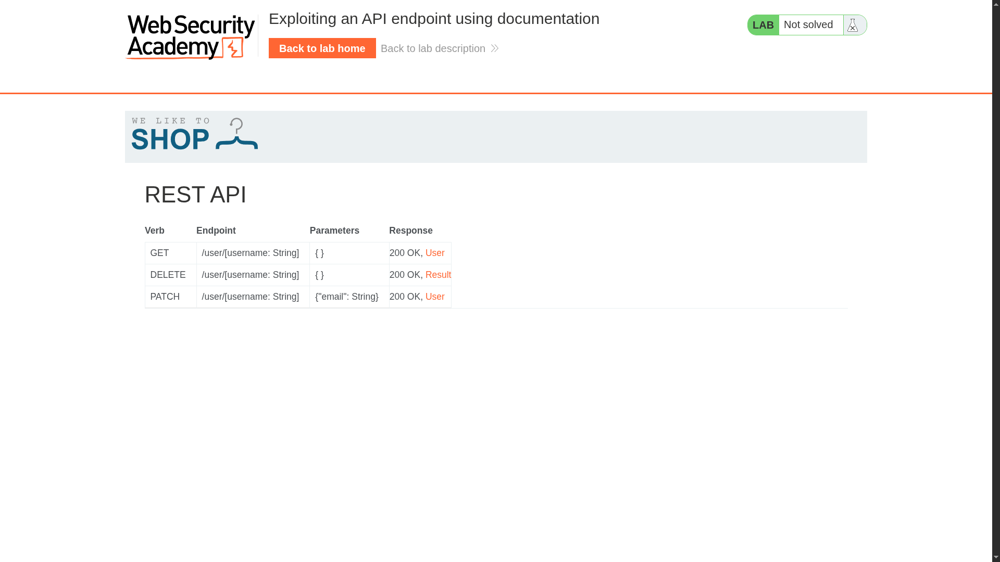

# Exploiting an API endpoint using documentation

**Lab Url**: [https://portswigger.net/web-security/api-testing/lab-exploiting-api-endpoint-using-documentation](https://portswigger.net/web-security/api-testing/lab-exploiting-api-endpoint-using-documentation)

## Objective

To solve the lab, find the exposed API documentation and delete `carlos`. You can log in to your own account using the following credentials: `wiener:peter`.

## Solution

The application exposes its interactive API documentation at an unlinked endpoint. By discovering the documentation, we can identify and execute an API endpoint that deletes user accounts.

### Step 1: Discover the API documentation endpoint

Log in to the application as `wiener:peter` and update your email address.

In your proxy's HTTP history, locate the `PATCH /api/user/wiener` request and capture it for editing and resending with any HTTP tool (e.g. Burp Repeater, curl, Postman).

Resend the `PATCH /api/user/wiener` request. The response returns account details for `wiener`.

Trim the path step by step to locate hidden endpoints:

- Remove `/wiener` to send `PATCH /api/user` -> returns an error because no user identifier is provided.
- Remove `/user` to send `GET /api` (or `PATCH /api`) -> response returns the API documentation.

### Step 2: Access the interactive API documentation

Open the `/api` URL in your browser.

The page renders an interactive API documentation interface.

### Step 3: Delete Carlos

In the interactive API documentation, locate the `DELETE /api/user/{username}` endpoint.

Click on the `DELETE` endpoint, enter `carlos` into the `username` field, and click **Send request**.

Carlos's account is deleted, solving the lab.
